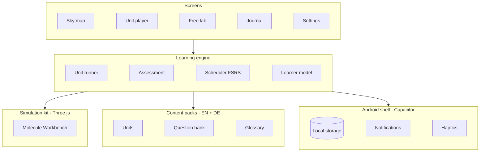
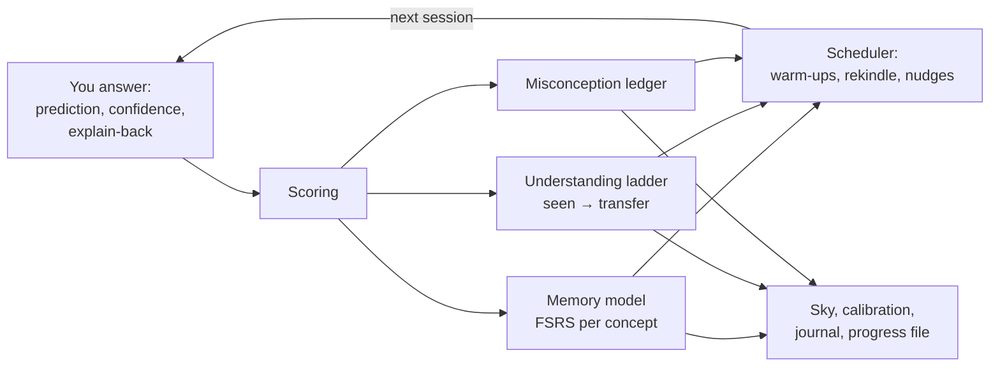

# Orbitarium

A planetarium for atoms: an offline chemistry learning app for Android, in English and German.
This is **phase 0, the vertical slice** — unit 6 (lone pairs and shape) runs end to end on the
Molecule Workbench, with the learner model, progress file and all 45 units on the map.

## How it fits together





## Run it in a browser (PowerShell)

```powershell
cd Orbitarium
npm install
npm run dev
# open the address it prints, e.g. http://localhost:5173
```

Add `?today=2026-11-15` to the address to pretend it is another day and watch concepts fade.

## Get the APK on your phone

The Android build runs on GitHub Actions, so you need no Android Studio. Every push to `main`
builds an APK and publishes it as a pre-release (**Releases → Orbitarium build N**). Open that
page on the phone, download the APK and allow installs from your browser once.

The repository is public, so two things live in **Settings → Secrets and variables → Actions**
instead of in the code:

| Secret | What it is | Without it |
| --- | --- | --- |
| `ANDROID_KEYSTORE_B64`, `ANDROID_KEYSTORE_PASSWORD`, `ANDROID_KEY_ALIAS` | The signing key (base64) and its password | Each build is signed with a throwaway key, so a new build only installs after uninstalling the old one |
| `SEED_PROGRESS` | Your chat-lesson history as a progress file | The welcome screen offers only "start fresh" and "import a file" |

To build locally instead you need Android Studio (or the SDK and JDK 21):

```powershell
npm run cap:sync
cd android
.\gradlew.bat assembleRelease
```

## Project layout

| Path | What it holds |
| --- | --- |
| `src/content/` | Curriculum (45 units), question bank, unit 6 content, glossary with false friends — all bilingual |
| `src/model/` | FSRS memory model, learner model, local store, readable progress file |
| `src/sim/` | Molecule Workbench: electron-pair physics (Three.js) and its controls |
| `src/ui/` | Screens: sky, unit player, questions, lab, journal, settings, onboarding |
| `android/` | Capacitor Android project (icons, splash, signing) |
| `tools/make_icons.py` | Regenerates launcher icons and splash screens |

## Content conventions

Strings are `{ en, de }` pairs. Inside them:

- `{{H2O}}` renders a formula with real subscripts, `{{NH4+}}` adds the charge
- `[[lone-pair]]` renders a tappable glossary term (both languages, definition, false friend)
- `Z_{eff}` renders a subscript, `**bold**` renders bold

## The progress file

Settings → Export writes one Markdown file with a small header. It is readable on its own,
can be edited by hand, and is the format for moving progress between the app and chat lessons.
Import merges: the more recent evidence per concept wins.

## Phase 0 scope

| Done | Next (phase 1) |
| --- | --- |
| Unit 6 end to end, seven steps | Units 1–11 and four more engines |
| Molecule Workbench with builder, polarity, wrong-model mode | Orbital Viewer, Charge Field, Lattice Builder, Particle Box |
| 9 of 10 assessment formats (case files come with modules) | Case files per module |
| FSRS memory, understanding ladder, misconceptions, calibration | Home-screen widget (phase 3) |
| EN/DE with term hints and false friends | |
| Progress file import/export; chat history injected at build time | |
| Weekly nudges and gap alert (Android) | |
